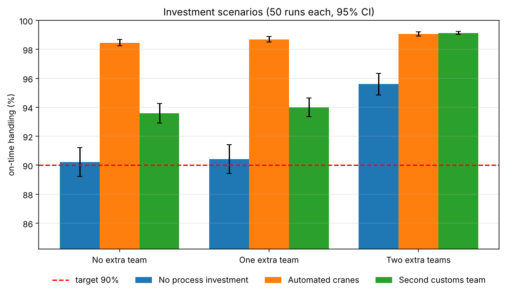
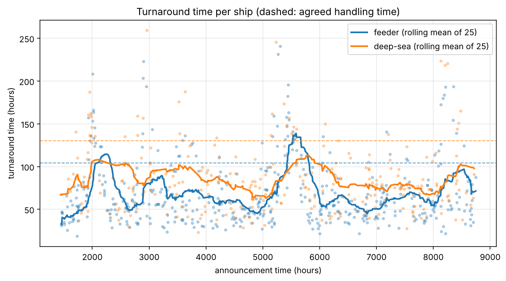

# terminalsim — Container Terminal Simulation

[](https://github.com/AlupuluiMarioStefan/Stochastic-CAPEX-Scenario-Simulator-for-Port-Terminal-Operations/actions/workflows/ci.yml)


A discrete-event simulation of a container terminal built with [SimPy](https://simpy.readthedocs.io/).
Ships are announced, quoted a fee, towed, unloaded by crane teams, inspected by customs and finally
shipped inland by barge — with opening hours, queues, restacking, security alerts and random
problems. On top of the simulation the package offers **reproducible runs, confidence intervals,
resource-utilisation statistics and an investment analysis** ("which investment is the cheapest way to
reach 90 % on-time handling?").

The project grew from a four-part simulation course assignment. Every part now runs through one
configurable, tested package with a command line interface.



## The four levels

| Level | What the model adds | Run it |
|---|---|---|
| **1** | Ships arrive (Poisson), get a fee quote and may be diverted; towing; 3 crane teams with opening hours; restacking; customs; barge delivery | `terminalsim simulate` |
| **2** | Reporting: turnaround times, diversion rates, restacking hours, plots | `terminalsim simulate --plot out.png` |
| **3** | Recorded arrivals from `ship_arrival_information.json`, warm-up period, replications, **investment comparison** (extra crane teams, automated cranes, second customs team) | `terminalsim invest` |
| **4** | Container scan and paper check run **in parallel**; security alerts **interrupt** scans | `terminalsim simulate --preset security` |

The full process description, the exact rules and the validation are in [docs/MODEL.md](docs/MODEL.md).

## Installation

```bash
git clone https://github.com/AlupuluiMarioStefan/Stochastic-CAPEX-Scenario-Simulator-for-Port-Terminal-Operations.git
cd Stochastic-CAPEX-Scenario-Simulator-for-Port-Terminal-Operations
python -m venv .venv && source .venv/bin/activate     # Windows: .venv\Scripts\activate
pip install -e ".[dev]"                                # simpy (+ matplotlib and pytest for plots and tests)
```

Only `simpy` is required at runtime; `matplotlib` is needed for `--plot`.

## Usage

### Command line

```bash
terminalsim simulate --seed 42                       # one year, full report + model self-check
terminalsim simulate --preset security --seed 42     # level 4
terminalsim simulate --arrivals data/ship_arrival_information.json --warmup 1440 --plot turnaround.png
terminalsim replicate --runs 30                      # mean ± 95 % confidence interval of all KPIs
terminalsim invest --runs 50 --plot investments.png  # compare all investment options
terminalsim config > my_config.json                  # dump the parameters, edit, then:
terminalsim simulate --config my_config.json
```

`simulate` also accepts `--json results.json` (counters, KPIs, resource statistics) and
`--csv ships.csv` (one row per ship with every timestamp). `python -m terminalsim ...` works too.
The exit code is `0` only if all statistical self-checks pass.

Example (`terminalsim simulate --seed 42`, abridged):

```
Service level
-------------
on-time handling:   99.5%  (agreed: feeder 104 h, deep-sea 130 h)
mean turnaround:    52.9 h  (feeder 47.2 h, deep-sea 63.3 h)

Resources
---------
resource   cap  util %  mean queue  max queue  mean wait h  max wait h
alpha        1    24.2        0.06          3          2.8        44.0
bravo        1    22.0        0.05          3          2.8        43.0
charlie      1    25.2        0.04          2          3.3        39.8
customs      1    36.0        0.06          2          1.3        32.2

Model self-check (observed vs. specification, tolerance = 3.5 standard errors)
  [OK] arrivals per week                  observed    8.3   expected    8.0   (n=433)
  [OK] share assigned to team charlie     observed   25.6   expected   25.0   (n=402)
  ...
```

### Python API

```python
from terminalsim import (RecordedArrivals, TerminalConfig, TerminalSimulation,
                         evaluate_investments, format_investment_report, replicate, summarize)

# one reproducible year
results = TerminalSimulation(seed=42).run(duration=8760)
print(results.ontime_percentage(), results.stations["customs"].utilization)

# your own scenario: what if the terminal also worked on Sundays?
from terminalsim import OpeningHours
cfg = TerminalConfig(opening=OpeningHours(closed_days=()))
arrivals = RecordedArrivals.from_json("data/ship_arrival_information.json")
runs = replicate(cfg, arrivals, runs=20)
print(summarize([r.ontime_percentage() for r in runs]))

# investment analysis
cfg = TerminalConfig(); cfg.warmup_hours = 1440
print(format_investment_report(evaluate_investments(arrivals, cfg, runs=50)))
```

More in [`examples/`](examples). Every parameter (fee ranges, crane-team shares and speeds, opening
hours, inspection times, ...) is a field of `TerminalConfig`; custom investments are
`Investment(name, cost, apply)` objects.

## Results

### Investment decision (level 3, 50 replications, target 90 % on time)

| | No process investment | Automated cranes (€35k) | Second customs team (€28k) |
|---|---|---|---|
| **No extra team** | 90.2 % ± 1.0 | 98.5 % ± 0.2 | 93.6 % ± 0.7 |
| **One extra team** (€55k) | 90.4 % ± 1.0 | 98.7 % ± 0.2 | 94.0 % ± 0.6 |
| **Two extra teams** (€77k) | 95.6 % ± 0.7 | 99.1 % ± 0.2 | 99.1 % ± 0.1 |

(mean ± half-width of the 95 % confidence interval)

* The **do-nothing case is a coin flip against the target** (90.2 % ± 1.0): with the 10 runs of the original
  script it can look like 89.6 % or 91.1 % depending on the seed. A confident decision needs more runs or
  paired comparisons.
* The **cheapest option that reliably reaches 90 % is the second customs team (€28,000)**. Customs is the
  bottleneck: one extra crane gang alone does nothing (+0.2 pp, CI includes 0), because the ships queue at
  the single customs team afterwards.
* Automated cranes give the biggest gain (+8.2 pp) but cost €7k more than the customs team.

### Turnaround over a year (recorded arrivals)

Bursts of arrivals around hours 2000, 5500 and 8200 build queues that the terminal needs weeks to clear:



## What is improved compared to the original scripts

| Area | Before | Now |
|---|---|---|
| Structure | four scripts, each a copy of the previous with additions | one configurable model; levels = configuration (`TerminalConfig`) |
| Parameters | hard-coded numbers inside the process logic | one serialisable config object, JSON in/out, validated |
| Opening hours / barges | 12-branch `if/elif` chains | `OpeningHours` / `BargeSchedule`, any hours, closed days |
| Randomness | global `random`, unseeded | per-run seed, per-ship random streams (common random numbers) |
| Results | ~30 loose counters | per-ship records (all timestamps) + the same counters derived from them |
| Statistics | 10 runs, compare point averages | confidence intervals, paired differences, stricter "confident" decision rule |
| Bottleneck insight | none | utilisation, queue length and waiting times per resource |
| Model checks | "Expected ~30 %" printed for a human | automatic checks with sample-size-aware tolerance |
| Verification | none | 56 tests incl. hand-calculated timelines; statistical equivalence test against the original scripts |
| Output | prints in the module body | text reports, JSON, CSV, plots, CLI |

Equivalence with the original scripts is checked, not assumed:

```bash
python tools/compare_with_legacy.py --runs 40
# 22 metrics (annual counts, turnaround, on-time % of 4 scenarios, alert counts): max |z| = 1.2
```

## Repository layout

```
.
├── src/terminalsim/
│   ├── config.py        # TerminalConfig and sub-configs, validation, JSON
│   ├── calendars.py     # opening hours, barge timetable
│   ├── arrivals.py      # generated (Poisson) and recorded arrivals
│   ├── model.py         # the SimPy processes
│   ├── stations.py      # resources with utilisation/queue statistics
│   ├── metrics.py       # per-ship records, Results, KPIs
│   ├── scenarios.py     # investment options
│   ├── experiments.py   # replications, confidence intervals, investment analysis
│   ├── validation.py    # statistical self-check
│   ├── report.py · plots.py · cli.py
├── data/                # recorded arrivals, preset configs as JSON
├── tests/               # 56 tests (unittest style, run by pytest)
├── tools/               # comparison against the legacy scripts
├── docs/                # MODEL.md, figures
├── examples/
└── legacy/              # the original course scripts, unchanged
```

## Development

```bash
pip install -e ".[dev]"
pytest
python tools/compare_with_legacy.py --runs 30
```

## License

[MIT](LICENSE) 
