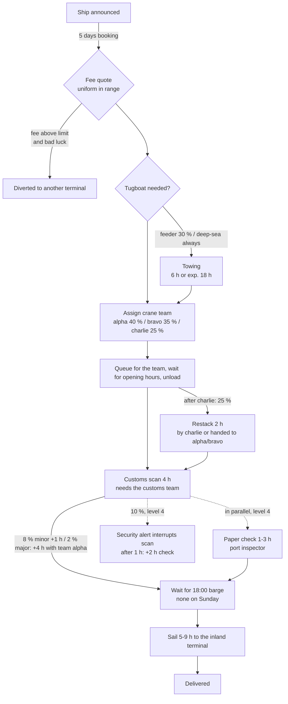

# Model description

This document explains what `terminalsim` simulates, which modelling decisions it makes, and how
the results are validated. Time is measured in **hours**; `t = 0` is Monday 00:00 and day 6 is Sunday.

## The process of one ship

| Task | Rule | Where in the code |
|---|---|---|
| 1 Booking | 120 h after announcement a fee is quoted: feeder U(4000, 12000), deep-sea U(25000, 60000). Above 9000 / 50000 the ship goes elsewhere with probability 30 % / 10 %. | `TerminalSimulation._ship` |
| 2 Docking | feeder: 30 % need a tug (6 h); deep-sea: always (exponential, mean 18 h). Tugs are unlimited. | `_ship` |
| 3 Unloading | One of three crane teams (own resource each, capacity 1): 8 h / 11 h / 16 h, only during opening hours (Mon-Sat 06-22). After charlie, 25 % need 2 h restacking: 20 % by charlie itself, otherwise by alpha or bravo. | `_unload` |
| 4 Inspection | Customs (capacity 1) scans 4 h in opening hours. 8 % minor problem (+1 h), 2 % major problem (+4 h, needs team alpha while customs is still held). Level 4: a port inspector checks papers 1-3 h *in parallel*; 10 % of scans are interrupted after 1 h by a security alert (2 h extra check, then the remaining 3 h). | `_scan`, `_alert`, `_paper_check` |
| 5 Delivery | Wait for the next 18:00 barge (not on Sundays), sail U(5, 9) h. Barges are unlimited. | `_ship` |

Arrivals are Poisson with 8 ships/week (65 % feeder), or read from `ship_arrival_information.json`
(968 ships in one year, level 3).

## Reading the course's rules precisely

A few rules of the assignment are easy to misread; the model reproduces them as written:

* **Opening hours are checked once, when work starts.** A crane team that has been granted to a ship
  is held through closed hours (the ship then "starts" at 06:00), and a task that begins in the evening
  is not paused when the terminal closes. The same holds for customs.
* **Customs is held while a major problem is repaired**, which needs team alpha. Alpha never waits for
  customs, so this cannot deadlock, but it makes alpha queues delay customs.
* **Turnaround time** is measured from fee confirmation (announcement + 120 h) to delivery, not from
  the announcement. The on-time KPI compares it with the agreed time (feeder 104 h, deep-sea 130 h).
* **Warm-up:** ships announced before hour 1440 are simulated (they fill the queues) but excluded
  from all KPIs.
* **Investments (level 3):** *n extra teams*: the first adds a second gang to team bravo, the second a
  second gang to charlie. *Automated cranes*: every unloading is 3 h shorter and the unloading team
  always restacks itself. *Second customs team*: customs capacity 2.
* In levels 1-2 and 4 ships still in the system when the year ends are not delivered; the delivered share
  is therefore a bit below 100 %.

## What `terminalsim` does differently from the scripts

### One configurable model instead of four scripts
All numbers above live in `TerminalConfig` (`terminalsim config` prints them as JSON). Level 4 is the
baseline plus `paper_check` and `security_alert`; investments are small functions that return a modified
copy of the config (`terminalsim.scenarios`).

### Reproducible runs with no global state
Each simulation owns its random numbers (`seed`), instead of calling the global `random` module.
The same seed always gives the same year.

### Common random numbers
Every ship carries its own pre-drawn uniform numbers (fee, diversion, tow, team, restack, problem,
...) seeded by `(seed, ship id)`. The same ship therefore has the *same luck* in every scenario that
uses the same seed. When two investment scenarios are compared, differences come from the investment,
not from noise: that is why `gain_vs_base` (paired differences) has much narrower confidence
intervals than the on-time percentages themselves. Without this, the base case of level 3 (true
on-time rate about 90.2 %) can look like 89.6 % or 91.1 % depending on the seed, which flips the
"meets the target" decision.

### Statistics
`replicate()` runs independent replications; `summarize()` returns mean, standard deviation and a
95 % Student-t confidence interval. `evaluate_investments()` reports both the course's criterion
(mean >= target) and a stricter one (lower end of the CI >= target).

### Monitored resources
`Station` wraps `simpy.Resource` and records time-averaged utilisation, queue length and waiting
times per crane team, customs and inspector, which makes bottlenecks visible (see
`Results.stations`).

## Validation

1. **Hand-calculated scenarios** (`tests/test_model.py`): with all randomness switched off, every
   timestamp is predictable, e.g. a feeder announced at t = 0 is quoted at 120, starts unloading at 126
   (Saturday 06:00), is cleared at 138 and delivered at 145. Queues, Sunday barges, alerts that
   interrupt scans, hand-overs for restacking and automated cranes are covered the same way.
2. **Calendar equivalence** (`tests/test_calendars.py`): the generalised opening hours and barge schedule
   reproduce the original hard-coded `if/elif` chains on 20,000 random times and on all boundaries.
3. **Statistical self-check** (`terminalsim.validation`): every run is compared with its own
   specification (arrival rate, ship mix, diversion, towing, team shares, restacking, problem rates,
   alert rate) with a tolerance of 3.5 standard errors that adapts to the sample size. A test confirms
   the checks fail when the specification is wrong.
4. **Equivalence with the original scripts** (`tools/compare_with_legacy.py`): original and new code
   are each run many times and 22 metrics are compared with two-sample z-tests (annual counts, mean
   turnaround, the on-time KPI of four investment scenarios, the level-4 alert counts). With 40 runs
   the largest |z| was 1.2.

## Limitations

* Work is not interrupted at closing time and crews do not take breaks (see above).
* Arrivals and processing times are stationary; there is no seasonality or weather.
* Only crane teams, customs and the inspector are constrained; berths, tugboats and barges are unlimited,
  as in the assignment.
* Investment costs are one-off numbers; there are no running costs or revenue.
